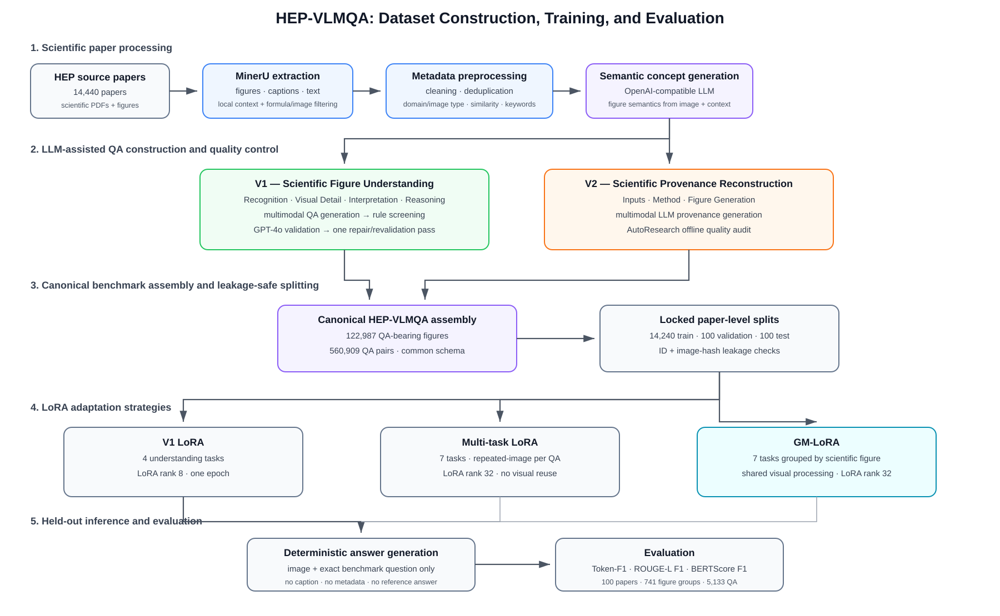

# HEP-VLMQA

## A Visual Question Answering Dataset for Benchmarking Vision-Language Models in High-Energy Physics

[](https://huggingface.co/datasets/amogneandualem/HEP-VLMQA)
[](https://github.com/amogneandualem/HEP-VLMQA)
[](LICENSE)

HEP-VLMQA is a multimodal benchmark for evaluating vision-language models on scientific figures from high-energy physics (HEP). It combines **Scientific Figure Understanding** with **Scientific Provenance Reconstruction** and provides a reproducible workflow from scientific-paper processing and benchmark construction to LoRA fine-tuning and held-out evaluation.

The repository also provides **Grouped Multitask LoRA (GM-LoRA)**, which groups multiple QA instances associated with the same scientific figure during multitask adaptation.

---

## Quick Links

| Resource | Link |
|---|---|
| Dataset | [Hugging Face: amogneandualem/HEP-VLMQA](https://huggingface.co/datasets/amogneandualem/HEP-VLMQA) |
| Source code | [GitHub: amogneandualem/HEP-VLMQA](https://github.com/amogneandualem/HEP-VLMQA) |
| Aggregate results | [`results/main_results.csv`](results/main_results.csv) |
| Per-task results | [`results/adapter_ablation.csv`](results/adapter_ablation.csv) |
| Paper | Coming soon |

---

## Dataset Availability

The HEP-VLMQA dataset is publicly available on Hugging Face:

**[amogneandualem/HEP-VLMQA](https://huggingface.co/datasets/amogneandualem/HEP-VLMQA)**

The release contains benchmark QA annotations and associated metadata for Scientific Figure Understanding and Scientific Provenance Reconstruction.

---

## Benchmark Overview

HEP-VLMQA contains two complementary task families.

| Task family | Objective | Tasks |
|---|---|---|
| **V1 — Scientific Figure Understanding** | Understand scientific visual content and meaning | Recognition, Visual Detail, Interpretation, Reasoning |
| **V2 — Scientific Provenance Reconstruction** | Reconstruct how a scientific figure was produced | Inputs, Method, Figure Generation |

### Benchmark Scale

| Statistic | Count |
|---|---:|
| Source papers | 14,440 |
| Source scientific images | 125,545 |
| QA-bearing papers | 14,435 |
| QA-bearing figures | 122,987 |
| V1 QA pairs | 455,360 |
| V2 QA pairs | 105,549 |
| **Total QA pairs** | **560,909** |

The broader source corpus contains 125,545 scientific images. The canonical benchmark contains 122,987 QA-bearing figures; source figures without accepted QA remain part of the source corpus but are not counted as QA-bearing benchmark figures.

### QA Distribution

| Family | Task | QA pairs |
|---|---|---:|
| V1 | Recognition | 118,129 |
| V1 | Visual Detail | 118,305 |
| V1 | Interpretation | 114,732 |
| V1 | Reasoning | 104,194 |
| V2 | Inputs | 35,183 |
| V2 | Method | 35,183 |
| V2 | Figure Generation | 35,183 |
|  | **Total** | **560,909** |

---

## Pipeline

<p align="center">
  
</p>

The workflow combines deterministic preprocessing and validation with LLM-assisted benchmark construction.

| Stage | Main method |
|---|---|
| Paper processing | MinerU extraction of figures, captions, paper text, and local context |
| Preprocessing | Cleaning, deduplication, rule-based domain/image-type classification, similarity grouping, and physics-keyword extraction |
| Semantic generation | OpenAI-compatible LLM generation of scientific figure semantics |
| V1 QA construction | Multimodal QA generation for Recognition, Visual Detail, Interpretation, and Reasoning |
| V1 quality control | Rule screening followed by GPT-4o validation and one repair/revalidation pass |
| V2 provenance construction | Multimodal LLM generation for Inputs, Method, and Figure Generation |
| V2 quality control | AutoResearch offline provenance audit |
| Dataset assembly | Common seven-task schema with canonical paper/image/QA identifiers |
| Split validation | Locked paper-level splits plus identifier and image-hash leakage checks |
| V1 LoRA | Joint adaptation on the four Scientific Figure Understanding tasks |
| Multi-task LoRA | Seven-task repeated-image-per-QA training without visual-feature reuse |
| GM-LoRA | Seven-task grouping by scientific figure with shared visual processing |
| Evaluation | Deterministic image + question inference using Token-F1, ROUGE-L F1, and BERTScore F1 |

LLM assistance is used for semantic generation, QA generation, and V1 validation. Dataset cleaning, canonical assembly, leakage checks, and the AutoResearch provenance audit are deterministic/offline stages.

---

## Dataset Construction

The benchmark-construction workflow is organized into eight stages.

| Stage | Purpose |
|---|---|
| `01_paper_processing` | Extract scientific figures, captions, text, and local context using MinerU |
| `02_preprocessing` | Clean figure metadata, captions, and surrounding scientific context |
| `03_semantic_generation` | Generate scientific semantic concepts |
| `04_qa_generation_validation` | Generate and validate four Scientific Figure Understanding QA types |
| `05_provenance_generation` | Generate three Scientific Provenance Reconstruction QA types |
| `06_autoresearch` | Audit provenance QA quality and consistency |
| `07_dataset_assembly` | Assemble the canonical seven-task HEP-VLMQA benchmark |
| `08_splits_and_grouping` | Apply the locked paper-level benchmark splits |

---

## Locked Benchmark Splits

HEP-VLMQA uses fixed paper-level train, validation, and test splits.

| Split | Papers |
|---|---:|
| Train | 14,240 |
| Validation | 100 |
| Test | 100 |
| **Total** | **14,440** |

All figures and QA pairs associated with the same source paper remain within the same split.

The split-preparation workflow checks for leakage using paper identifiers, QA identifiers, image identifiers, and image-content hashes.

---

## Held-Out Test Benchmark

| Statistic | Count |
|---|---:|
| Papers | 100 |
| Figure groups | 741 |
| V1 QA | 3,240 |
| V2 QA | 1,893 |
| **Total QA** | **5,133** |

### Test QA Distribution

| Task | QA |
|---|---:|
| Recognition | 776 |
| Visual Detail | 773 |
| Interpretation | 805 |
| Reasoning | 886 |
| Inputs | 631 |
| Method | 631 |
| Figure Generation | 631 |
| **Total** | **5,133** |

---

## Training Strategies

Three LoRA adaptation settings are represented in the release.

### V1 LoRA

The V1 baseline trains jointly on the four Scientific Figure Understanding QA types.

| Setting | Value |
|---|---:|
| Training examples | 366,343 |
| LoRA rank | 8 |
| LoRA alpha | 16 |
| Learning rate | 1e-4 |
| Epochs | 1 |
| Best validation loss | 1.01424 |
| Optimizer steps | 45,792 |

Code:

```text
training/v1_lora/
├── train.py
└── config.json
```

### Multi-task LoRA

The matched Multi-task LoRA baseline jointly trains all seven QA types while processing each image-question instance independently.

| Setting | Value |
|---|---:|
| LoRA rank | 32 |
| LoRA alpha | 64 |
| LoRA dropout | 0.05 |
| Learning rate | 1e-4 |
| Weight decay | 0.01 |
| Epochs | 1 |
| Best validation loss | 1.31017 |
| Optimizer steps | 31,013 |
| Visual feature reuse | No |

Code:

```text
training/multitask_lora/
├── train.py
└── config.json
```

### Grouped Multitask LoRA

GM-LoRA groups QA instances associated with the same scientific figure.

| Setting | Value |
|---|---:|
| Grouped training records | 124,065 |
| Processed real groups | 123,183 |
| LoRA rank | 32 |
| LoRA alpha | 64 |
| LoRA dropout | 0.05 |
| Learning rate | 1e-4 |
| Weight decay | 0.01 |
| Epochs | 1 |
| Best validation loss | 1.11964 |
| Optimizer steps | 30,809 |
| Training GPUs | 4 |

Code:

```text
training/grouped_multitask_lora/
├── train.py
└── config.json
```

The principal controlled methodological comparison is **Multi-task LoRA vs. GM-LoRA**.

---

## Main Results

All reported benchmark scores use **Token-F1**, **ROUGE-L F1**, and **BERTScore F1**.

### Overall Seven-Task Micro Performance

| Model | Token-F1 | ROUGE-L F1 | BERTScore F1 |
|---|---:|---:|---:|
| Multi-task LoRA | 0.5285 | 0.5063 | 0.9180 |
| **GM-LoRA** | **0.5348** | **0.5119** | **0.9191** |

### Seven-Task Macro Performance

| Model | Token-F1 | ROUGE-L F1 | BERTScore F1 |
|---|---:|---:|---:|
| Multi-task LoRA | 0.5197 | 0.4973 | 0.9159 |
| **GM-LoRA** | **0.5274** | **0.5040** | **0.9173** |

### Scientific Figure Understanding — V1 Macro

| Model | Token-F1 | ROUGE-L F1 | BERTScore F1 |
|---|---:|---:|---:|
| V1 LoRA | 0.5821 | 0.5645 | 0.9300 |
| **Multi-task LoRA** | **0.6066** | **0.5883** | **0.9338** |
| GM-LoRA | 0.6037 | 0.5863 | 0.9333 |

### Scientific Provenance Reconstruction — V2 Macro

| Model | Token-F1 | ROUGE-L F1 | BERTScore F1 |
|---|---:|---:|---:|
| Multi-task LoRA | 0.4038 | 0.3760 | 0.8920 |
| **GM-LoRA** | **0.4257** | **0.3942** | **0.8960** |

GM-LoRA improves the overall seven-task micro and macro metrics and all three V2 provenance metrics relative to the matched repeated-image Multi-task LoRA baseline.

On V1, performance remains similar, with Multi-task LoRA slightly higher on the four-task macro metrics.

The V1 LoRA model is evaluated on 3,240 V1 QA pairs; its overall micro score should therefore not be interpreted as a directly comparable seven-task micro score.

Full-precision aggregate results are available in [`results/main_results.csv`](results/main_results.csv).

---

## Per-Task Adapter Ablation

Scores below are reported in percent.

### Scientific Figure Understanding

| QA Type | Single Tok | Single R-L | Single BERT | Multi Tok | Multi R-L | Multi BERT | GM Tok | GM R-L | GM BERT | ΔMT | ΔGM |
|---|---:|---:|---:|---:|---:|---:|---:|---:|---:|---:|---:|
| Recognition | 64.72 | 64.16 | 93.32 | **68.02** | 67.05 | 93.84 | 67.72 | **67.15** | 93.77 | +3.30 | -0.31 |
| Visual Detail | 70.11 | 69.11 | 95.04 | **71.92** | **71.28** | **95.33** | 71.40 | 70.50 | 95.21 | +1.81 | -0.52 |
| Interpretation | 53.04 | 51.03 | 92.42 | **55.58** | **53.39** | **92.75** | 55.46 | 53.20 | **92.75** | +2.54 | -0.12 |
| Reasoning | 44.98 | 41.48 | 91.23 | **47.09** | 43.60 | **91.60** | 46.89 | **43.66** | **91.60** | +2.11 | -0.20 |
| **Understanding Macro** | **58.21** | **56.45** | **93.00** | **60.66** | **58.83** | **93.38** | **60.37** | **58.63** | **93.33** | **+2.45** | **-0.29** |

### Scientific Provenance Reconstruction

| QA Type | Single Tok | Single R-L | Single BERT | Multi Tok | Multi R-L | Multi BERT | GM Tok | GM R-L | GM BERT | ΔMT | ΔGM |
|---|---:|---:|---:|---:|---:|---:|---:|---:|---:|---:|---:|
| Inputs | 36.81 | 38.34 | 88.52 | 40.98 | 37.82 | 88.36 | **42.10** | **38.61** | **88.66** | +4.17 | +1.12 |
| Method | 32.20 | 36.38 | 89.37 | 37.59 | 35.27 | 89.21 | **39.75** | **36.82** | **89.47** | +5.39 | +2.16 |
| Figure Generation | 39.70 | 41.92 | 90.47 | 42.58 | 39.70 | 90.03 | **45.85** | **42.83** | **90.66** | +2.88 | +3.27 |
| **Provenance Macro** | **36.24** | **38.88** | **89.46** | **40.38** | **37.60** | **89.20** | **42.57** | **39.42** | **89.60** | **+4.14** | **+2.18** |

`ΔMT` = Multi-task − Single-task.
`ΔGM` = GM-LoRA − Multi-task.

The understanding-task differences between GM-LoRA and Multi-task LoRA are small, whereas GM-LoRA consistently improves provenance Token-F1.

Full per-task values are available in [`results/adapter_ablation.csv`](results/adapter_ablation.csv).

---

## Evaluation Protocol

The model receives only:

```text
scientific figure + exact benchmark question
```

No caption, reference answer, semantic annotation, provenance metadata, task label, or retrieved paper context is supplied to the model during inference.

Generation is deterministic.

| Task family | Maximum generated tokens |
|---|---:|
| V1 | 32 |
| V2 | 256 |

### Metrics

| Metric | Description |
|---|---|
| **Token-F1** | Token-level overlap between generated and reference answers |
| **ROUGE-L F1** | Longest-common-subsequence similarity |
| **BERTScore F1** | Contextual semantic similarity |

Evaluation code:

```text
evaluation/
├── generate_answers.py
├── evaluate.py
└── summarize_results.py
```

---

## Repository Structure

```text
HEP-VLMQA/
├── assets/
│   └── hep_vlmqa_pipeline.svg
├── dataset/
│   ├── 01_paper_processing/
│   ├── 02_preprocessing/
│   ├── 03_semantic_generation/
│   ├── 04_qa_generation_validation/
│   ├── 05_provenance_generation/
│   ├── 06_autoresearch/
│   ├── 07_dataset_assembly/
│   └── 08_splits_and_grouping/
├── training/
│   ├── v1_lora/
│   ├── multitask_lora/
│   └── grouped_multitask_lora/
├── evaluation/
│   ├── generate_answers.py
│   ├── evaluate.py
│   └── summarize_results.py
├── results/
│   ├── v1_lora/
│   ├── multitask_lora/
│   ├── grouped_multitask_lora/
│   ├── main_results.csv
│   └── adapter_ablation.csv
├── README.md
├── requirements.txt
├── LICENSE
├── CITATION.cff
└── .gitignore
```

---

## Installation

```bash
git clone https://github.com/amogneandualem/HEP-VLMQA.git
cd HEP-VLMQA

python -m venv .venv
source .venv/bin/activate

pip install --upgrade pip
pip install -r requirements.txt
```

### MinerU

Stage 01 additionally requires MinerU for scientific-paper extraction. Install a MinerU release appropriate for your operating system and accelerator environment before running the paper-processing stage.

---

## Reproducing the Dataset Pipeline

```bash
python dataset/01_paper_processing/extract_papers_mineru.py --help
python dataset/02_preprocessing/preprocess_metadata.py --help
python dataset/03_semantic_generation/generate_semantic_concepts.py --help
python dataset/04_qa_generation_validation/generate_and_validate_qa.py --help
python dataset/05_provenance_generation/generate_provenance_qa.py --help
python dataset/06_autoresearch/audit_provenance_qa.py --help
python dataset/07_dataset_assembly/build_hep_vlmqa.py --help
python dataset/08_splits_and_grouping/prepare_locked_splits.py --help
```

Scripts using external generation services read API credentials from environment variables. Credentials must never be committed to the repository.

---

## Training

Training implementations and released configurations are provided under:

```text
training/v1_lora/
training/multitask_lora/
training/grouped_multitask_lora/
```

The public configurations use portable relative paths rather than cluster-specific filesystem paths.

---

## Evaluation

Generate predictions:

```bash
python evaluation/generate_answers.py --help
```

Evaluate predictions:

```bash
export HEPVLMQA_PREDICTIONS=/path/to/predictions
export HEPVLMQA_TEST_DATA=/path/to/test_grouped.jsonl
export HEPVLMQA_METRICS_DIR=results/evaluation
export HEPVLMQA_BERTSCORE_MODEL=/path/to/roberta-large
export HEPVLMQA_MODEL_NAME="GM-LoRA"

python evaluation/evaluate.py
```

Regenerate the aggregate result table:

```bash
python evaluation/summarize_results.py
```

---

## Reproducibility

The release preserves:

- fixed paper-level train, validation, and test definitions;
- cross-split leakage checks;
- successful training configurations;
- deterministic held-out generation;
- a common evaluation protocol;
- machine-readable aggregate and per-task results;
- portable filesystem configuration.

The canonical benchmark contains **560,909 QA pairs**.

Derived grouped or repeated-image training representations should not be interpreted as alternative benchmark sizes.

Large model checkpoints, optimizer states, raw paper archives, full-resolution source-image collections, and raw prediction dumps are intentionally excluded from GitHub.

---

## Data and Model Availability

The HEP-VLMQA benchmark dataset is publicly available on Hugging Face:

**Dataset:** [amogneandualem/HEP-VLMQA](https://huggingface.co/datasets/amogneandualem/HEP-VLMQA)

This GitHub repository contains benchmark-construction code, training configurations, evaluation code, documentation, and compact experimental results.

Large trained model checkpoints and LoRA adapters may be distributed separately through model repositories.

Third-party scientific papers, figures, pretrained models, and external resources remain subject to their respective licenses and usage conditions.

---

## Citation

If you use HEP-VLMQA, please cite the accompanying paper.

Citation metadata is provided in [`CITATION.cff`](CITATION.cff).

The final paper citation can be added when publication metadata becomes available.

---

## License

See [`LICENSE`](LICENSE).

Third-party scientific papers, figures, pretrained models, and external datasets remain subject to their respective licenses and usage conditions.
