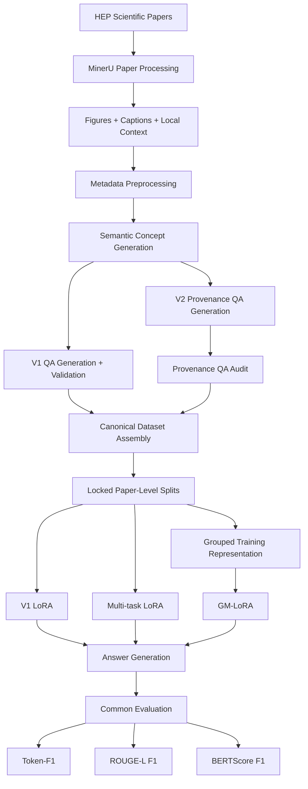

# HEP-VLMQA

**HEP-VLMQA: Benchmarking Scientific Figure Understanding with Grouped Multitask LoRA Training**

HEP-VLMQA is a multimodal benchmark and training framework for scientific figure understanding in high-energy physics (HEP). It combines **Scientific Figure Understanding** with **Scientific Provenance Reconstruction** and provides a reproducible workflow from scientific-paper processing and benchmark construction to LoRA fine-tuning and evaluation.

The repository also provides **Grouped Multitask LoRA (GM-LoRA)**, a multitask adaptation strategy that groups multiple QA instances associated with the same scientific figure to reduce redundant visual processing during training.

---

## Overview

HEP-VLMQA contains two complementary benchmark components.

| Task family | Objective | Tasks |
|---|---|---|
| **V1 — Scientific Figure Understanding** | Understand scientific visual content and meaning | Recognition, Visual Detail, Interpretation, Reasoning |
| **V2 — Scientific Provenance Reconstruction** | Reconstruct how a scientific figure was produced | Inputs, Method, Figure Generation |

### Benchmark scale

| Statistic | Count |
|---|---:|
| Source papers | 14,440 |
| Source scientific images | 125,545 |
| QA-bearing papers | 14,435 |
| QA-bearing figures | 122,987 |
| V1 QA pairs | 455,360 |
| V2 QA pairs | 105,549 |
| **Total QA pairs** | **560,909** |

The broader source corpus contains 125,545 scientific images. The canonical benchmark contains 122,987 QA-bearing figures; source figures without accepted QA remain part of the source corpus but are not counted as benchmark QA-bearing figures.

### QA distribution

| Family | Task | QA pairs |
|---|---|---:|
| V1 | Recognition | 118,129 |
| V1 | Visual Detail | 118,305 |
| V1 | Interpretation | 114,732 |
| V1 | Reasoning | 104,194 |
| V2 | Inputs | 35,183 |
| V2 | Method | 35,183 |
| V2 | Figure Generation | 35,183 |
|  | **Total** | **560,909** |

---

## Pipeline



The pipeline separates dataset construction, training, and evaluation so that each component can be reproduced and audited independently.

---

## Dataset Construction

The dataset workflow is organized into eight stages.

| Stage | Purpose |
|---|---|
| `01_paper_processing` | Extract scientific figures, captions, paper text, and local context using MinerU |
| `02_preprocessing` | Clean figure metadata, captions, and surrounding context |
| `03_semantic_generation` | Generate scientific semantic concepts |
| `04_qa_generation_validation` | Generate and validate the four V1 QA types |
| `05_provenance_generation` | Generate the three V2 Scientific Provenance Reconstruction QA types |
| `06_autoresearch` | Audit provenance QA quality and consistency |
| `07_dataset_assembly` | Assemble the canonical seven-task HEP-VLMQA benchmark |
| `08_splits_and_grouping` | Apply the locked paper-level benchmark splits |

The canonical benchmark representation associates each QA instance with stable paper, image, task-family, QA-type, question, answer, and provenance metadata.

---

## Locked Benchmark Splits

HEP-VLMQA uses fixed **paper-level** train, validation, and test splits.

| Split | Papers |
|---|---:|
| Train | 14,240 |
| Validation | 100 |
| Test | 100 |
| **Total** | **14,440** |

All figures and QA pairs originating from the same paper remain within the same split.

The split-preparation workflow checks for cross-split leakage using paper identifiers, QA identifiers, image identifiers, and image-content hashes.

---

## Held-Out Test Benchmark

The locked test benchmark contains 100 papers and 741 scientific figure groups.

| Statistic | Count |
|---|---:|
| Papers | 100 |
| Figure groups | 741 |
| V1 QA | 3,240 |
| V2 QA | 1,893 |
| **Total QA** | **5,133** |

### Test QA distribution

| Task | QA |
|---|---:|
| Recognition | 776 |
| Visual Detail | 773 |
| Interpretation | 805 |
| Reasoning | 886 |
| Inputs | 631 |
| Method | 631 |
| Figure Generation | 631 |
| **Total** | **5,133** |

---

## Training Strategies

Three LoRA adaptation settings are included in the release.

### 1. V1 LoRA

The V1 LoRA baseline is trained on the four Scientific Figure Understanding tasks.

| Setting | Value |
|---|---:|
| Training examples | 366,343 |
| LoRA rank | 8 |
| LoRA alpha | 16 |
| Learning rate | 1e-4 |
| Epochs | 1 |
| Gradient accumulation | 8 |
| Best validation loss | 1.01424 |
| Optimizer steps | 45,792 |

Implementation:

```text
training/v1_lora/
├── train.py
└── config.json
```

---

### 2. Multi-task LoRA

The matched Multi-task LoRA baseline jointly trains all seven QA types.

Each image-question instance is processed independently, so a scientific figure associated with several questions may be visually encoded repeatedly.

| Setting | Value |
|---|---:|
| LoRA rank | 32 |
| LoRA alpha | 64 |
| LoRA dropout | 0.05 |
| Learning rate | 1e-4 |
| Weight decay | 0.01 |
| Epochs | 1 |
| Best validation loss | 1.31017 |
| Optimizer steps | 31,013 |
| Visual feature reuse | No |

Implementation:

```text
training/multitask_lora/
├── train.py
└── config.json
```

---

### 3. Grouped Multi-task LoRA

GM-LoRA groups QA instances associated with the same scientific figure.

Conceptually:

```text
Scientific figure
       │
       ├── Recognition
       ├── Visual Detail
       ├── Interpretation
       ├── Reasoning
       ├── Inputs
       ├── Method
       └── Figure Generation
       │
       ▼
Grouped visual processing
       │
       ▼
Shared multitask LoRA optimization
```

| Setting | Value |
|---|---:|
| Grouped training records | 124,065 |
| Processed real groups | 123,183 |
| LoRA rank | 32 |
| LoRA alpha | 64 |
| LoRA dropout | 0.05 |
| Learning rate | 1e-4 |
| Weight decay | 0.01 |
| Epochs | 1 |
| Best validation loss | 1.11964 |
| Optimizer steps | 30,809 |
| Training GPUs | 4 |

Implementation:

```text
training/grouped_multitask_lora/
├── train.py
└── config.json
```

The principal controlled methodological comparison is **Multi-task LoRA vs. GM-LoRA**.

---

## Main Results

HEP-VLMQA reports **Token-F1**, **ROUGE-L F1**, and **BERTScore F1**.

### Overall seven-task micro performance

| Model | Token-F1 | ROUGE-L F1 | BERTScore F1 |
|---|---:|---:|---:|
| Multi-task LoRA | 0.5285 | 0.5063 | 0.9180 |
| **GM-LoRA** | **0.5348** | **0.5119** | **0.9191** |

### Seven-task macro performance

| Model | Token-F1 | ROUGE-L F1 | BERTScore F1 |
|---|---:|---:|---:|
| Multi-task LoRA | 0.5197 | 0.4973 | 0.9159 |
| **GM-LoRA** | **0.5274** | **0.5040** | **0.9173** |

### V1 — Scientific Figure Understanding

| Model | Token-F1 | ROUGE-L F1 | BERTScore F1 |
|---|---:|---:|---:|
| V1 LoRA | 0.5821 | 0.5645 | 0.9300 |
| **Multi-task LoRA** | **0.6066** | **0.5883** | **0.9338** |
| GM-LoRA | 0.6037 | 0.5863 | 0.9333 |

### V2 — Scientific Provenance Reconstruction

| Model | Token-F1 | ROUGE-L F1 | BERTScore F1 |
|---|---:|---:|---:|
| Multi-task LoRA | 0.4038 | 0.3760 | 0.8920 |
| **GM-LoRA** | **0.4257** | **0.3942** | **0.8960** |

GM-LoRA improves the overall seven-task micro and macro metrics and all three V2 provenance metrics relative to the matched repeated-image Multi-task LoRA baseline. On V1, performance remains similar, with Multi-task LoRA slightly higher on the four-task macro metrics.

The dedicated V1 LoRA model is evaluated only on the 3,240 V1 test QA pairs; its overall micro score should therefore not be directly compared with the seven-task micro scores computed over all 5,133 QA pairs.

Full-precision results are available in:

```text
results/main_results.csv
```

and the experiment-specific `test_metrics.json` files.

---

## Evaluation Protocol

All fine-tuned models use the same held-out evaluation protocol.

The model receives only:

```text
scientific figure + exact benchmark question
```

No caption, semantic annotation, provenance metadata, task label, retrieved paper context, or reference answer is supplied to the model during inference.

Generation is deterministic.

| Task family | Maximum generated tokens |
|---|---:|
| V1 | 32 |
| V2 | 256 |

### Evaluation metrics

| Metric | Description |
|---|---|
| **Token-F1** | Token-level overlap between generated and reference answers |
| **ROUGE-L F1** | Longest-common-subsequence similarity |
| **BERTScore F1** | Contextual semantic similarity |

The common evaluation implementation is provided in:

```text
evaluation/
├── generate_answers.py
├── evaluate.py
└── summarize_results.py
```

---

## Repository Structure

```text
HEP-VLMQA/
├── dataset/
│   ├── 01_paper_processing/
│   │   └── extract_papers_mineru.py
│   ├── 02_preprocessing/
│   │   └── preprocess_metadata.py
│   ├── 03_semantic_generation/
│   │   └── generate_semantic_concepts.py
│   ├── 04_qa_generation_validation/
│   │   └── generate_and_validate_qa.py
│   ├── 05_provenance_generation/
│   │   └── generate_provenance_qa.py
│   ├── 06_autoresearch/
│   │   └── audit_provenance_qa.py
│   ├── 07_dataset_assembly/
│   │   └── build_hep_vlmqa.py
│   └── 08_splits_and_grouping/
│       └── prepare_locked_splits.py
│
├── training/
│   ├── v1_lora/
│   │   ├── train.py
│   │   └── config.json
│   ├── multitask_lora/
│   │   ├── train.py
│   │   └── config.json
│   └── grouped_multitask_lora/
│       ├── train.py
│       └── config.json
│
├── evaluation/
│   ├── generate_answers.py
│   ├── evaluate.py
│   └── summarize_results.py
│
├── results/
│   ├── v1_lora/
│   │   ├── training_summary.json
│   │   └── test_metrics.json
│   ├── multitask_lora/
│   │   ├── training_summary.json
│   │   └── test_metrics.json
│   ├── grouped_multitask_lora/
│   │   ├── training_summary.json
│   │   └── test_metrics.json
│   └── main_results.csv
│
├── README.md
├── requirements.txt
├── LICENSE
├── CITATION.cff
└── .gitignore
```

Historical smoke tests, checkpoints, raw prediction dumps, machine-specific paths, and obsolete experimental scripts are intentionally excluded from the public release.

---

## Installation

Clone the repository and create an isolated Python environment:

```bash
git clone https://github.com/amogneandualem/HEP-VLMQA.git
cd HEP-VLMQA

python -m venv .venv
source .venv/bin/activate

pip install --upgrade pip
pip install -r requirements.txt
```

A CUDA-capable GPU is required for VLM training and recommended for inference.

---

## Reproducing the Dataset Pipeline

Run the dataset-construction stages in order.

```bash
python dataset/01_paper_processing/extract_papers_mineru.py --help

python dataset/02_preprocessing/preprocess_metadata.py --help

python dataset/03_semantic_generation/generate_semantic_concepts.py --help

python dataset/04_qa_generation_validation/generate_and_validate_qa.py --help

python dataset/05_provenance_generation/generate_provenance_qa.py --help

python dataset/06_autoresearch/audit_provenance_qa.py --help

python dataset/07_dataset_assembly/build_hep_vlmqa.py --help

python dataset/08_splits_and_grouping/prepare_locked_splits.py --help
```

Scripts requiring external generation services read credentials from environment variables. API credentials must not be committed to the repository.

---

## Training

Training implementations and released configurations are located under:

```text
training/v1_lora/
training/multitask_lora/
training/grouped_multitask_lora/
```

The public configurations contain portable relative paths rather than cluster-specific filesystem locations.

Inspect the supported options before launching a training run:

```bash
python training/v1_lora/train.py --help
python training/multitask_lora/train.py --help
python training/grouped_multitask_lora/train.py --help
```

---

## Evaluation

### 1. Generate answers

```bash
python evaluation/generate_answers.py --help
```

The generator uses the image and exact benchmark question only.

### 2. Evaluate predictions

Example:

```bash
export HEPVLMQA_PREDICTIONS=/path/to/predictions
export HEPVLMQA_TEST_DATA=/path/to/test_grouped.jsonl
export HEPVLMQA_METRICS_DIR=results/evaluation
export HEPVLMQA_BERTSCORE_MODEL=/path/to/roberta-large
export HEPVLMQA_MODEL_NAME="GM-LoRA"

python evaluation/evaluate.py
```

### 3. Build the consolidated result table

```bash
python evaluation/summarize_results.py
```

This generates:

```text
results/main_results.csv
```

---

## Reproducibility

The publication release preserves:

- fixed paper-level train, validation, and test manifests;
- cross-split leakage checks;
- successful training configurations;
- deterministic held-out generation;
- a common evaluation protocol across fine-tuned models;
- compact machine-readable training and evaluation summaries;
- portable filesystem configuration.

The canonical benchmark contains **560,909 QA pairs**.

Derived training representations used for multitask optimization should not be interpreted as alternative benchmark sizes.

Large checkpoints, optimizer states, raw paper archives, full-resolution source-image collections, and large prediction dumps are intentionally excluded from GitHub.

---

## Data and Model Availability

The GitHub repository is intended for source code, configuration files, benchmark manifests, documentation, and compact result files.

Large dataset archives and trained model adapters should be distributed separately through appropriate dataset and model repositories when released.

---

## Citation

If you use HEP-VLMQA, please cite the accompanying paper.

Citation metadata is provided in:

[`CITATION.cff`](CITATION.cff)

The final paper citation can be added after publication metadata is available.

---

## License

See [`LICENSE`](LICENSE) for the repository license.

Third-party scientific papers, figures, pretrained models, and external datasets remain subject to their respective licenses and usage conditions.
